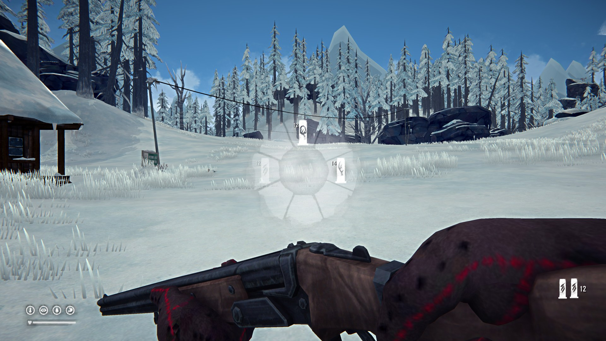
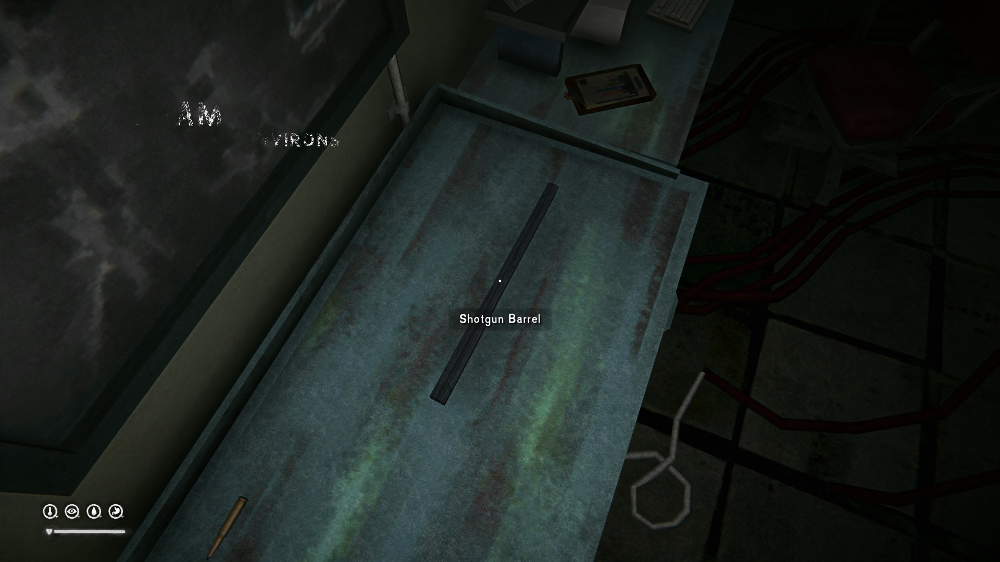
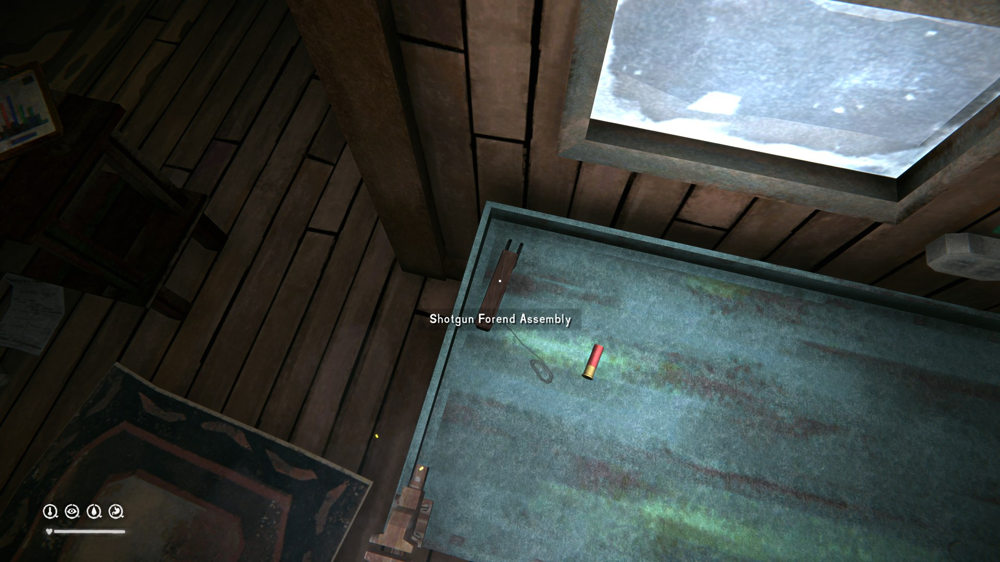
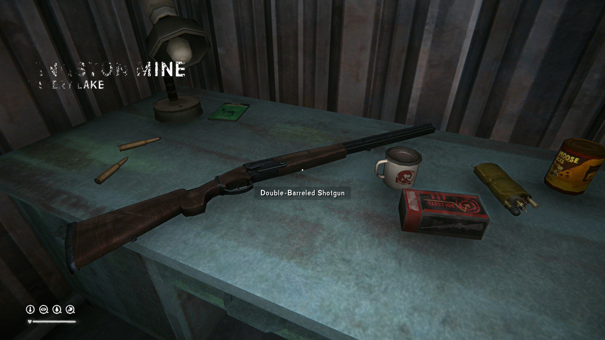
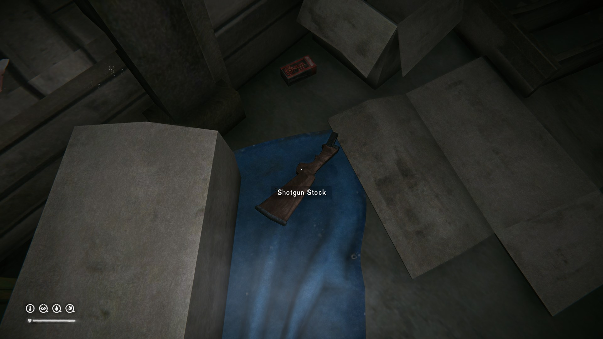
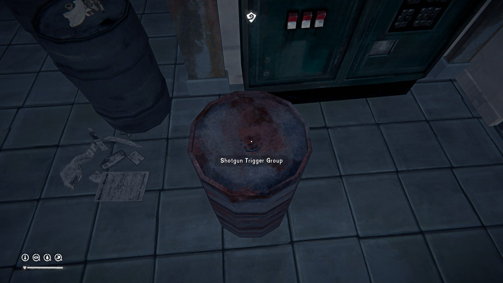

# Double-Barreled Shotgun

*Double Barrel All The Way*

- Hold **Left Alt** while firing to fire both barrels at once
- Tap **T** to cycle to the next shell type, or hold it for the ammo wheel:
  - Slugs
  - Buckshot
  - Birdshot
  - ??? Stay Tuned ???
- Make it (barrel, stock, forend, trigger) or find it on Voyager or Pilgrim
- Find or make your own ammo, just like vanilla
- Level up a dedicated skill with optional integration with Filigrani's Skills
- (Open Beta Only) Many aspects can be changed in Mod Settings; experiment and enjoy!

<b>Spoilers: Geoguessing with a Double Barrel</b>

## Installation

- MelonLoader 0.7.2
- [ModComponent](https://github.com/dommrogers/ModComponent/releases/latest/download/ModComponent.dll)
- [ModSettings](https://github.com/DigitalzombieTLD/ModSettings/releases/latest/download/ModSettings.dll)
- [ModData](https://github.com/dommrogers/ModData/releases/latest/download/ModData.dll)
- [MehToolBox](https://github.com/monsieurmeh/MehToolBox/releases/latest/download/MehToolBox.dll)
- [AudioCore](https://github.com/DigitalzombieTLD/AudioCore/releases/latest/download/AudioCore.dll) (goes in /plugins/)
- [AudioManager](https://github.com/DigitalzombieTLD/AudioManager/releases/latest/download/AudioManager.dll)
- [Filigrani's Skills](https://github.com/No3371/TLD-FiligranisSkills/releases/latest/download/FiligranisSkills.dll) (optional)
- Pop [DoubleBarrel.dll](https://github.com/monsieurmeh/Shotgun/releases/latest/download/DoubleBarrel.dll) in /mods/ and enjoy the show

## Team Shotgun
- [Kai](https://www.patreon.com/cw/Kaiusername1) - 2D & 3D Artwork for Shotgun & Ammo
- [Waltz](https://www.artstation.com/fardyhernandez) - 3D Animation
- [Flower Field](https://ko-fi.com/flowerfield123) - 2D & 3D Artwork for custom skill content
- Mako - Sound Design
- [Lithar](https://www.youtube.com/@Lithar-TheLongDark) - Marketing like a boss
- [MonsieurMeh](https://github.com/monsieurmeh) - Programming

Special shoutout to everyone that helped me test in 2026!
- Red (red6785)
- Viola (romiebee2077)
- System Ether (systeme_ether)
- TKG (thekillergreece)
- Gavin (gavinrod)

If you don't see your name here tell me and I will fix! You know how forgetful I am.
